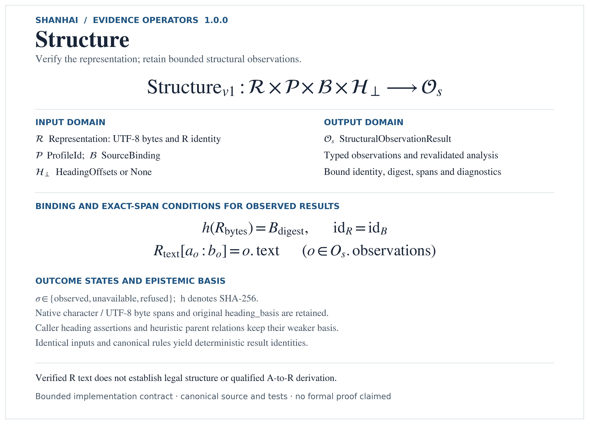
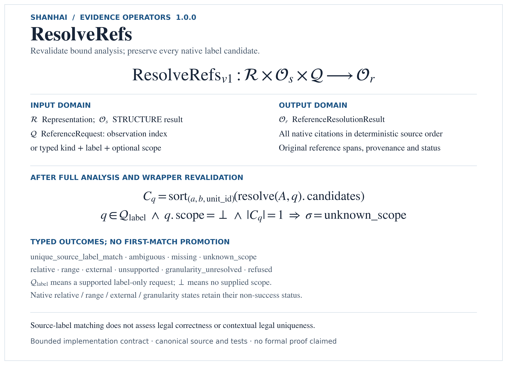

> Pre-3.6 publication: current bounded implementation and synthetic checks.
> See [qualification, installation and test commands](docs/PRE36_QUALIFICATION.md).
> Internal engineering acceptance is distinct from independent external review; V3.6 is pending.

<p align="center">
  
</p>

[English](README.md) | [简体中文](README.zh-CN.md) | [繁體中文](README.zh-TW.md) | [日本語](README.ja.md)

# ShanHai（海珊）

**Legal Text Evidence Skill**

ShanHai is an independently usable open-source Skill for structured legal and
textual evidence extraction and citation. It reads UTF-8 legal text, detects legal
structure, and emits evidence units carrying exact character, byte and line spans.
It reconstructs citations that can be re-checked against the artifact, and reports
structural problems as distinct, inspectable outcomes instead of guessing.

Nothing is inferred silently: a value that was not read is reported as loss, a
location that is not unique is reported as ambiguity, and a problem with the
document's structure is reported as a typed diagnostic.

* **Standalone use is a first-class supported mode.** ShanHai can be cloned,
  tested and used without access to the private SeaFlow base runtime.
* **SeaFlow integration is optional.** When integrated with SeaFlow, ShanHai acts
  as an official SeaFlow Skill/plugin — but that integration is implemented on
  SeaFlow's side, and standalone use does not require it.

---

<p align="center">
  
</p>

## Capabilities

These are the capabilities the Skill declares at runtime. Anything not listed is
not implemented.

| Capability | Support | What it does |
| --- | --- | --- |
| Legal-text evidence units | supported | one evidence unit per detected article, plus container units for chapters, or for a document that yielded no provisions |
| Structural diagnostics | supported | `empty_artifact`, `unsupported_structure`, `missing_marker`, `malformed_marker`, `numbering_gap`, `duplicate_marker`, `encoding_failure` — kept distinct |
| Exact span location | supported | character, UTF-8 byte and 1-based line spans recorded per provision, computed from the artifact bytes |
| Text citation reconstruction | supported | an article, a paragraph or a character span rebuilds to an exact, re-verifiable citation |
| Paragraph splitting | partial | paragraphs are blank-line separated blocks inside an article; a single-paragraph article yields one block |
| Retrieval or ranking | unsupported | no retrieval, ranking, FTS, similarity or fuzzy matching exists in this Skill, by decision |
| OCR and non-text input | unsupported | only UTF-8 text is read; images, PDFs and binary formats are not text artifacts |
| Legal authority | unsupported | this Skill records *where* text is; it makes no claim about whether that text is in force, applicable or authoritative |

Ambiguity is a result, not an error: a duplicated article marker returns every
candidate and selects none. There is no first-match fallback anywhere.

ShanHai does **not** provide legal advice, semantic legal reasoning, LLM
generation, autonomous agents, verified legal authority, or universal
legal-format support.

## Currently Indexed and Searchable Legal Sources

The list below covers legal materials that are **both ingested and searchable**:
ShanHai has read the text and can locate exact provisions in it. Where a source
has several language versions, each searchable version is listed in its own
language, because a rendering in another language is not automatically
equivalent in authority.

This repository is a **Skill, not a corpus**. It ships the extraction capability
only. **The underlying legal-source texts are not distributed here**, so cloning
this repository does not give you any of the sources listed below — the Skill and
the legal corpus are separate.

ShanHai does not itself retrieve or rank: it locates and cites provisions inside
the source it is given, and matching or selection belongs to the caller.

### Chinese Law (中国法)

| Source | What it is |
| --- | --- |
| `CN_Constitution` | 中华人民共和国宪法 |
| `CN_Criminal_Law` | 中华人民共和国刑法 |
| `CN_Criminal_Procedure_Law` | 中华人民共和国刑事诉讼法 |
| `CN_Civil_Code` | 中华人民共和国民法典 |
| `CN_Civil_Procedure_Law` | 中华人民共和国民事诉讼法 |
| `CN_Maritime_Law_2025` | 中华人民共和国海商法 |
| `CN_ECOLOGICAL_ENVIRONMENT_CODE_2026` | 中华人民共和国生态环境法典 |
| `CN_SPECIAL_MARITIME_PROCEDURE_LAW_1999` | 中华人民共和国海事诉讼特别程序法 |
| `CN_LAW_APPLICABLE_TO_FOREIGN_RELATED_CIVIL_RELATIONS_2010` | 中华人民共和国涉外民事关系法律适用法 |
| `CN_Anti-Unfair_Competition_Law` | 中华人民共和国反不正当竞争法 |
| `CN_Arbitration_Law` | 中华人民共和国仲裁法 |
| `CN_Bankruptcy_Law` | 中华人民共和国企业破产法 |
| `CN_Counterespionage_Law` | 中华人民共和国反间谍法 |
| `CN_Cybersecurity_Law` | 中华人民共和国网络安全法 |
| `CN_Labour_Law` | 中华人民共和国劳动法 |
| `CN_Maritime_Traffic_Safety_Law` | 中华人民共和国海上交通安全法 |
| `CN_Securities_Law` | 中华人民共和国证券法 |
| `CN_Regulation_Water_Transport` | 国内水路运输管理条例 |
| `CN_Provisions_Water_Transport` | 国内水路运输管理规定 |
| `CN_Provisions_on_Trade_Secret_Protection` | 商业秘密保护规定 |

### Japanese Law (日本法)

| Source | What it is |
| --- | --- |
| `JP_INTL_CARRIAGE_GOODS_BY_SEA_2018` | 国際海上物品運送法 — Act No. 172 of 1957, searchable in its Japanese text |

### Hague / Hague-Visby System

Held locally but **not yet searchable** through ShanHai.

| Held but not yet searchable | Why |
| --- | --- |
| Hague Rules 1924, Visby Protocol 1968, SDR Protocol 1979 | English `Article N` headings |
| Consolidated Hague-Visby text | A derived consolidation of the same three instruments; also English `Article N` headings |

ShanHai therefore reports them as an unsupported structure rather than guessing at
their articles. They are deliberately **not** listed among the searchable sources
above, because they cannot currently be searched or cited.

### UN Conventions and Related Materials

Held locally but **not yet searchable** through ShanHai.

| Held but not yet searchable | Why |
| --- | --- |
| New York Convention 1958 | Its Chinese rendering is searchable in principle, but its issuing organ and depositary are not evidenced in the held text, so it is withheld pending review; the English rendering and both PDFs are unreadable to this Skill |
| Rotterdam Rules 2008 | Searchable only in a Chinese rendering whose authority is unevidenced, and four of its articles cannot be selected unambiguously; the English rendering and both PDFs are unreadable to this Skill |
| Hamburg Rules 1978 | English `Article N` headings. Its Common Understanding is an interpretive annex of the Convention, not a separate instrument, and is not independently citable |
| UNCLOS 1982 | English `Article N` headings |
| UK Public General Act 1995 c.21 (candidate) | Scanned-image PDF; identity not established from the text |

UNCLOS is held as a source package — the Convention text together with its
integral annexes and Final Act material. Those annexes are components of the
Convention, not separate instruments.

The Rotterdam Rules entry above is the one case where a held rendering *is*
searchable: its Chinese text resolves article numbers, but four articles return
several candidates and none is selected, and the rendering's authority status is
unevidenced. It is listed here rather than above so that the limitation stays
visible next to the name.

### Known limitation affecting the Civil Code

The Chinese Civil Code is searchable, but **some article numbers written with the
Chinese numeral containing “千” cannot currently be located**, so a citation to
those articles cannot be resolved from the held text — in practice the articles
above number 999. Every other listed source resolves at article level. The same
numeral limitation was observed independently on a separately maintained copy of
the Ecological Environment Code.

## Installation

Standard library only. There is no package to install and no service to start:

```bash
git clone https://github.com/HuDeyi-66/Shan_Hai_Code_Skill
cd Shan_Hai_Code_Skill
python --version        # qualified on Windows with CPython 3.13.14
```

That is the whole installation.

## Minimal standalone example

One function is the whole required surface:

```python
from skills.shanhai import run_legal_text_evidence

result = run_legal_text_evidence("statute.txt", source_id="statute")

print(result.is_complete_success)          # False if anything was lost
for unit in result.units:
    print(unit.address.value, unit.loss)   # exact location, and what is missing
```

`run_legal_text_evidence` accepts a filesystem path, raw bytes, or a
`TextArtifact` you build yourself. It returns a run result carrying the evidence
units, the run diagnostics, and an honest assessment of whether the read was
complete. A document that yielded nothing still returns a result — with the loss
recorded — rather than raising.

Lower-level entry points are available if you want to drive the pieces:

```python
from skills.shanhai import ShanHaiLegalTextEvidence, TextArtifact, FixtureTextBackend

artifact = TextArtifact.from_file("statute.txt", "statute")
result = ShanHaiLegalTextEvidence(FixtureTextBackend()).run(
    artifact, source_id="statute"
)
```

There is also a runnable example in the repository:

```bash
python examples/shanhai_legal_text_example.py
```

## Testing

```bash
python tests/run_all.py --quiet
```

No runtime, service, sibling checkout or external path is required. A dedicated
isolation suite proves it: it fails if any module under `skills/` acquires an
import of a private runtime, it checks that importing the package loads no such
module, and it runs the entry point and the example from a fresh interpreter
whose path contains **only this repository**.

## Known limitations

* **UTF-8 legal text only.** No PDF, DOCX, OCR or spreadsheets. A format outside
  the Skill's capability is refused rather than attempted.
* **Chinese legal markers.** Article and chapter detection targets numbered
  Chinese markers (`第X条`, `第X章`). `Article N`-style Latin headings are outside
  this Skill's scope and are reported as an unsupported structure.
* **Chinese numerals containing 千 are not resolved.** Some article numbers
  written with Chinese numerals cannot currently be located, so a citation to
  them cannot be resolved. This is specific to the numeral form, not to article
  magnitude: a text using half-width digits is unaffected.
* **Table-of-contents / body chapter ambiguity.** Chapter markers inside a table
  of contents and genuine body chapter structures cannot always be distinguished
  reliably, and repeated chapter numbering can be legitimate when numbering
  restarts across Parts. This affects chapter context only; article-level
  evidence is unaffected, and no blind deduplication is performed.
* **UTF-8 only for encoding.** A BOM-less legacy encoding is reported as an
  encoding failure rather than guessed at.
* **Paragraph splitting is partial.** Paragraphs are blank-line separated blocks;
  deeper intra-article structure is not modelled.
* **No retrieval or ranking.** Matching and selection belong to a caller.
* **No legal authority.** Extraction and location only.
* **Platform qualification.** Qualified on Windows with CPython 3.13.14. The
  runtime imports only the standard library, so nothing pins it to that
  environment, but other versions and platforms have not been qualified.

## Relationship with SeaFlow

ShanHai is one of two independently published open-source Skills. SeaFlow can
integrate it as an official Skill/plugin; standalone use does not require access
to the private SeaFlow base runtime.

The dependency runs one way only:

```
SeaFlow (private runtime)  ---adapts--->  ShanHai (this repository)
```

ShanHai never imports SeaFlow. Nothing here changes if you never use SeaFlow.

* SeaFlow public informational entry point:
  <https://github.com/HuDeyi-66/SeaFlow>

The links in this section are **discovery links**, not runtime dependency
declarations.

## Relationship with LuoHai

LuoHai（海珞） — Tabular Evidence Skill — is ShanHai's **sibling Skill**, not a
dependency. Neither Skill imports the other, in either direction, and that
isolation is asserted by test.

* LuoHai repository: <https://github.com/HuDeyi-66/Luo_Hai_Tables_Skill>

## Opt-in multilingual evidence (V3.4-A development)

The separate `skills.shanhai.multilingual` API provides versioned, bounded
profiles for Chinese, English, Japanese, Russian, French, Arabic, German,
Spanish and Portuguese (separate European/Brazilian drafting declarations).
It preserves original UTF-8 bytes, maps matching views back to original spans,
reports ambiguous/unresolved references, and reconstructs digest-bound citations.
Lexical cues and declared-translation structural candidates do not assert legal
effect, equivalence, authority or temporal validity. The existing API is unchanged.

Read the [contract and limitations](docs/MULTILINGUAL_1_0_0.md), inspect the
[versioned schemas/profiles](schemas/multilingual/1.0.0/), or run the
[synthetic standalone example](examples/multilingual_example.py):

```bash
python -B examples/multilingual_example.py
python -B -m unittest discover -s tests/multilingual -v
```

These are development conformance capabilities, not a claim of universal legal
understanding or independently benchmarked nine-language accuracy. No acquired
legal-library text, private research or new third-party runtime dependency is included
in this repository. The analyzer API is separate from the opt-in formal evidence
operators below.

## Opt-in source-faithful chunking

`skills.shanhai.chunking` adds a separately versioned exact-span interface for
declared `zh/en/ja/ru/fr/ar/de/es/pt` text. It keeps original artifact and qualified
text-representation identities separate, partitions the complete retained text,
enforces a Unicode-codepoint budget and records structural-cue fallback. Optional
context chunks are separate from primary coverage. Native chunk citations can be
reconstructed and checked against the original representation.

See [the chunking contract and limitations](docs/chunking-v1.md). Existing evidence,
analyzer and citation APIs remain unchanged. This interface makes no substantive
legal interpretation, automatic-language-detection or universal drafting-family
recognition claim. Source qualification remains an external precondition.

## Formal Evidence Operators

The opt-in `skills.shanhai.operators_v1` module exposes the bounded **1.0.0**
contracts below. These rendered equations describe the implemented interfaces
and tested checks; they are not mathematical proofs of legal semantics. The
existing analyzer, citation and chunking interfaces retain their own scopes.

This operator section is currently maintained in English. The Chinese and
Japanese README translations do not yet include it; consult this section for
the current operator contracts.

### Structure

Verifies the bound text representation and delegates structural observation to
the canonical multilingual analyzer.



**Types:** `Representation` supplies exact UTF-8 bytes and an R identifier;
`ProfileId`, `SourceBinding` and optional `HeadingOffsets` supply the declared
context. `StructuralObservationResult` returns typed observations, canonical
analysis, original spans, identities, diagnostics and a stable result ID.

**Scope:** text presence is verified against R. Caller heading assertions,
heuristic structural cues and parent relations remain explicitly qualified.
Legal structure and an original-artifact-to-R derivation are not independently
verified; requiring unavailable source qualification produces a refusal.
See the [Structure 1.0.0 contract](docs/operators-v1.md#structure) and
[transport schema](schemas/operators/1.0.0/structure.schema.json).

### ResolveRefs

Revalidates the full bound analysis and Structure result before native label
matching, retaining all candidates in deterministic source order.



**Types:** `Representation`, `StructuralObservationResult` and `ReferenceRequest`
(an observation index, or kind/label/optional scope) produce a
`ReferenceResolutionResult` with native citation candidates, original reference
coordinates, provenance and a typed outcome.

**Scope:** a unique source-label match does not establish substantive legal
correctness or contextual legal uniqueness. Missing, ambiguous, unknown-scope,
relative, range, external, unsupported and granularity-unresolved references
retain explicit states; altered analysis is refused. There is no cross-document
or cross-version inference.
See the [ResolveRefs 1.0.0 contract](docs/operators-v1.md#resolve_refs) and
[transport schema](schemas/operators/1.0.0/resolve_refs.schema.json).

The [rendering source and pinned documentation-only dependencies](docs/assets/operators/README.md) are retained with the PNGs.

## License

The same-stage Cycle2 opt-in update emits evidence/profile **1.1.0**. See
[migration, detection modes and limitations](docs/MULTILINGUAL_1_1_0.md).
Cycle1's incomplete verdict is retained as historical evidence; this update does
not claim independently adjudicated nine-language acceptance or a later stage.

MIT. See `LICENSE`.

```
Copyright (c) 2026 Peng Wang (Hu Deyi)
```

This license covers this repository. It does not extend to the private SeaFlow
base runtime, which is separately maintained; this repository makes no licensing
statement about it. See `DEPENDENCIES.md`.
